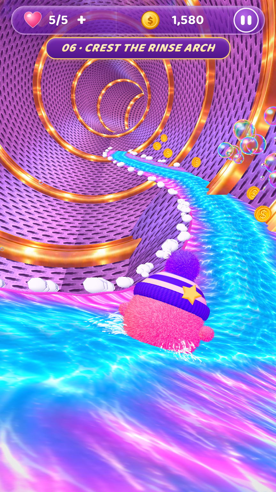

# Screen 06 pictures

The first three pictures show the opening. The fourth shows the deeper passage. The last two show a separate character experiment. Both Codex experiments await owner approval. Tap any picture to open the original file.

## APPROVED · Original Screen 06 artwork

## CLAUDIA BEFORE · Retained gameplay opening

## CODEX NEW · Curved washer passage at the opening

## CODEX NEW · Swimming deeper into the curved passage

## CODEX NEW · Separate lighter-pink Benny candidate

## CODEX NEW · Native crop of the separate fur candidate

