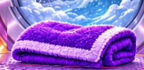

# Would a generated object help Rainbow?

**Keep the fal budget at $0 for now.** Among the five playable scenes, the folded purple towel on Screen 08 is the clearest possible single-object test. The artwork shows a curled end, overlapping folds and a sewn edge. The playable towel currently uses six subdivided flat faces. From the front, the projected cloth still reads well. From the side, the question is whether its folds have enough real depth. Claudia also saved a silhouette mask specifically for the rectangular corner beside the cloth. [Original approved Screen 08](03_SCREENS/Screen_08/APPROVED_ORIGINAL.jpg) · [Claudia’s retained towel geometry](https://github.com/josiahscalia5-dev/rainbow-/blob/3c0fa97090afb2c0fca41898774db7247e23e522/src/world/match08.ts#L683)

## The one source image

Use only `references/08_final_spin_chamber.png`, SHA-256 `ab7d0bc5777bc9b262ec0563839a51663d4ec271e4a099c8d417b2de5f498e14`. The original is 864 × 1536. The visible outline of the towel spans approximately 196 × 63 source pixels. The proposed transparent crop retains those native pixels and 10 pixels of padding on each edge. The existing larger silhouette mask supplies the boundary. It adds no cloth detail. Only this one view is verified for this fold. Its back, underside and depth would be interpretations for the owner to review. [Original detail](PHONE_PICTURES/FAL_08_approved_towel.png) · [Proposed input crop, kept private](PHONE_PICTURES/FAL_08_towel_cutout.png)

## Free test in the existing game

I rendered four matching camera positions in Claudia’s retained Three.js game. Switching on her saved towel outline removes most of the rectangular door pixels attached to the towel during hard steering. The right-hand curl and the stitched trim still read clearly. A smaller pale patch remains behind the left fold. Adding her saved door-occlusion texture barely changes that patch at hard right. This points to a small mask or depth-assignment issue to isolate before commissioning a new solid. No Screen 08 game source changed.

At the approved opening, the visible cloth interior has the same mean RGB error of 4.5832 against the artwork with the outline off and on. Across the whole opening only 20 pixels change by more than 10 in any channel. At hard right the outline changes 7,869 pixels, all in the cropped region around the towel. These are pixel-change counts at matched game poses. The original artwork supplies no hard-right target. [Four matched camera states and measurements](PHONE_PICTURES/FAL_08_towel_check.json)

**Claudia’s retained hard-right view**

**Same gameplay with Claudia’s saved towel outline enabled**

## One conditional paid test

**Meshy 7.1 Image to 3D, USD $0.80 for one geometry-only generation at the published settings.** This endpoint explicitly returns a GLB mesh and accepts a triangle target and disabled symmetry for the uneven curl. Its potential advantage over Blender or Image2Blender is the time saved drafting an irregular, folded solid. The front is already close and the hidden shape has no photographic ground truth. There is no measured evidence that Meshy would be more accurate. A Blender roll fitted to the front silhouette and a fitted Image2Blender model can both retain the existing artwork, scale and platform contact. An existing 604-triangle paddle already fits the Screen 07 paddle outline, and the Screen 08 spout positions and lips are modeled. The biggest moving defects on the other screens follow the watercourse or repeating tunnel surfaces. Those require changes to the course geometry, UVs or material assignment. [Meshy’s price](https://fal.ai/models/meshy/v7.1/image-to-3d) · [Input and output schema](https://fal.ai/models/meshy/v7.1/image-to-3d/api)

| Setting | Proposed value |
| --- | --- |
| Endpoint | `meshy/v7.1/image-to-3d` |
| Input | One temporary PNG cutout of the original towel |
| Geometry | `model_type=standard`, `geometry_resolution=standard` |
| Remesh | `should_remesh=true`, `topology=triangle`, `target_polycount=2400` |
| Symmetry | `symmetry_mode=off` |
| Optional outputs | `should_texture=false`, `enable_pbr=false`, `enable_rigging=false`, `enable_animation=false` |
| Deliverable | One editable GLB to inspect and fit in Blender. Reuse the approved purple cloth and seam colors. |

The estimate for quantity one also returned USD $0.80. The published texture option brings the total to $1.20 and is unnecessary here. No art was uploaded to fal. No job ran and no credits were used.

## Current fal alternatives

| Model | Price for the stated option | What the schema means for this towel |
| --- | --- | --- |
| Meshy 7.1 single / multi-image | $0.80 geometry, $1.20 textured | Required GLB, face target, remeshing and asymmetry control. Multi-image accepts up to four angles of one object. Only one verified angle is available. [Single](https://fal.ai/models/meshy/v7.1/image-to-3d) · [Multi](https://fal.ai/models/meshy/v7.1/multi-image-to-3d) |
| Tripo H3.1 single / multiview | $0.20 untextured, $0.30 standard texture, $0.40 HD texture. Detailed geometry adds $0.20, quads add $0.05. | Face limit and orientation aligned with the image. Required mesh can be GLB or FBX. Multi takes two to four ordered views of one object. No measured quality advantage on Rainbow. [Single](https://fal.ai/models/tripo3d/h3.1/image-to-3d) · [Multiview](https://fal.ai/models/tripo3d/h3.1/multiview-to-3d) |
| Hunyuan 3D Pro v3.1 | $0.375 base. PBR, multiview and custom face count each add $0.15. | GLB output. The smallest advertised face setting is 40,000. A cloth prop at this scale would need substantial reduction. [Hunyuan](https://fal.ai/models/fal-ai/hunyuan-3d/v3.1/pro/image-to-3d) |
| TRELLIS 2 | $0.25 at 512, $0.30 at 1024, $0.35 at 1536 | GLB, UV and mesh simplification controls. Higher output resolution cannot reveal the hidden folds in this 196-pixel-wide source. [TRELLIS](https://fal.ai/models/fal-ai/trellis-2) |
| SAM 3D Objects | $0.02 per listed generation unit | Accepts a mask, point or box. A mesh GLB is optional alongside its splat output. Rainbow already has a mask. Only mesh geometry would be eligible for gameplay. [SAM 3D](https://fal.ai/models/fal-ai/sam-3/3d-objects) |

## How an authorized GLB would earn a place

1. Check the GLB’s actual triangle count, winding, normals, UV orientation, material count and sizes. Fit the visible curl on the correct side, keep the bottom on the existing platform and match the approved silhouette. The current proxy is about 6.95 units wide, 2.90 high and 3.20 deep. The depth is an existing modeling choice.
2. Render the retained, outline and proposed mesh using the same camera, position, steering, lighting and shader clock. At the opening compare the whole 864 × 1536 frame, the cloth outline overlap, and its edge error in pixels. Inspect the sewn trim and contact shadow at full size.
3. Capture +3, +6, +10 and +20 units wherever still inside the chamber, both hard turns, the platform, the final bend and the exit. Record the real inlet-to-exit swim. Check whether the roll reveals a coherent side, sits on the platform, occludes the door correctly and remains clear of the four spouts. Present side views separately for owner approval. Similarity percentages apply only where an approved camera reference exists.
4. Keep the existing gameplay checks at 8/8, 91 coins, score 1,330 to 2,240 and five hearts on the safe ride. Check sustained frame time and memory on a physical Android before promotion. Save attractive failures alongside their camera evidence and leave the retained game intact.

## Tools for the five playable worlds

Use the official Blender Lab MCP v1.0.3 with the isolated Blender 5.3.0 installation for editable geometry. A fresh read-only call opened the saved Screen 07 Image2Blender environment, confirmed the reference camera, two curved banks, two foam meshes, two guide curves and the packed bank and foam images. Image2Blender’s pinned reference and specification helpers also passed. The saved bank geometry is evidence from an earlier experiment with its own approval status.

Use Microsoft Playwright and the existing Rainbow motion-matching skill to steer the actual Three.js game and record identical rides before and after each correction. Inspect the full frames and uninterrupted clips. The existing Pixelmatch script measures the original opening and identifies unintended differences. Local object masks and edge measurements isolate the issue under test. Review hidden angles and sustained Android device performance separately. [Rainbow motion-matching instructions](https://github.com/josiahscalia5-dev/rainbow-/blob/3b57658f78fd5d7dce498d2743f1a09a173a570a/.agents/skills/rainbow-visual-motion-matcher/SKILL.md)

## Sleek

The connected Sleek design tool accepts image references and exports editable HTML for mobile interfaces. Its exposed rendering tool captures those interface screens. It exposes no mesh export, Blender scene editing, WebGL geometry inspection or real gameplay capture. Spending Sleek design credits would not address the water, ring, foam or cloth depth in Rainbow.

## Checkpoints used

The lead `ccr-bbe2b27e-oxfh1w` was at `d22ec46b72146d69703d4271cd54c1c852164dff`. The retained chamber came from `claude/rainbow-s08-scenery-c17` at `3c0fa97090afb2c0fca41898774db7247e23e522`. All five approved game images were verified against the repository’s reference hashes. The assessment used the existing real-game captures and the specialist source, with no paid model output. [All five screens and swimming footage](OPEN_RAINBOW_ON_ANDROID.md)
