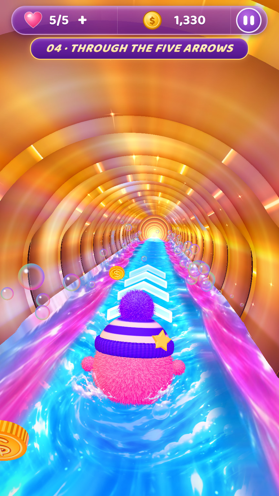
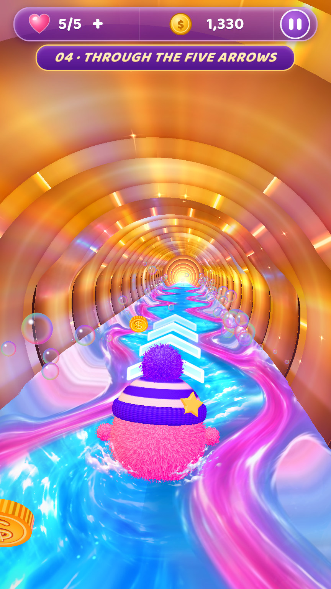
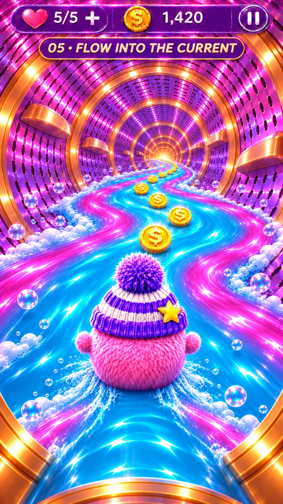
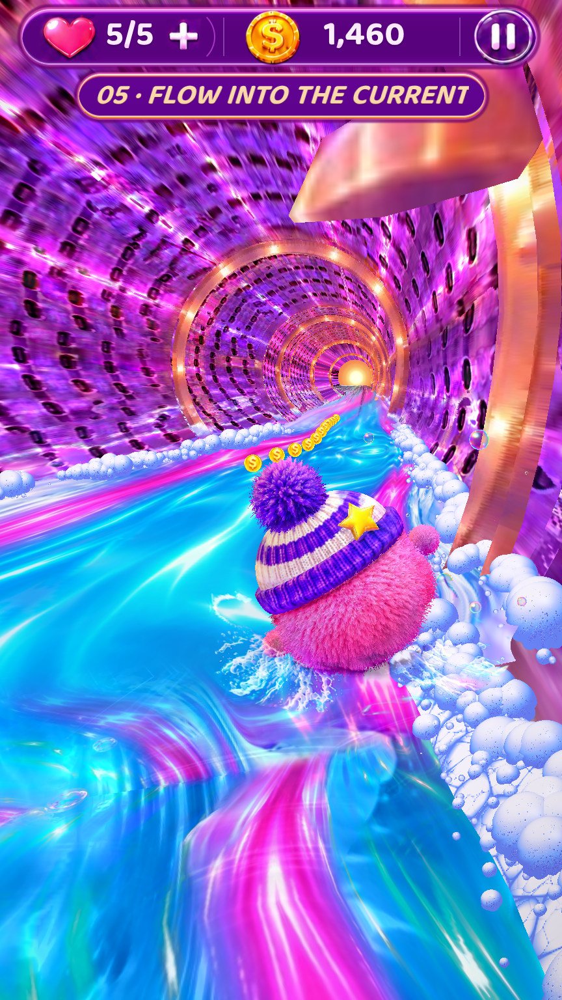
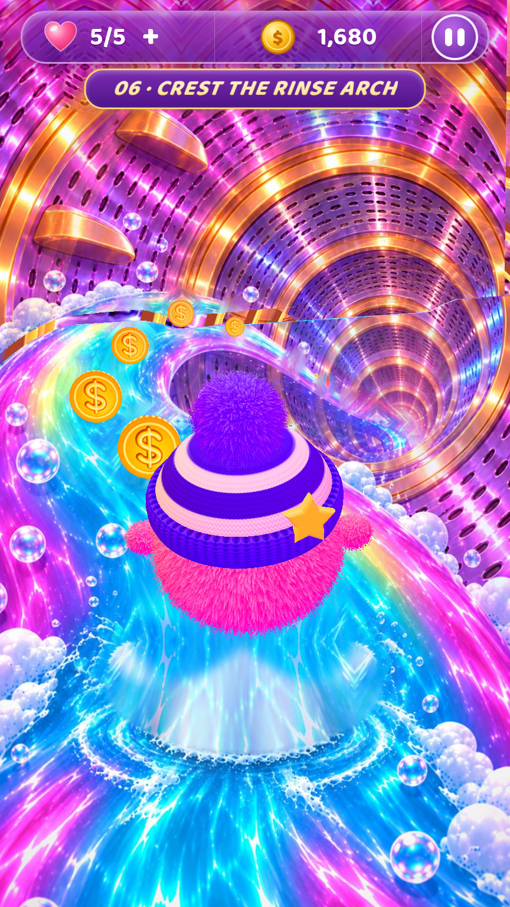
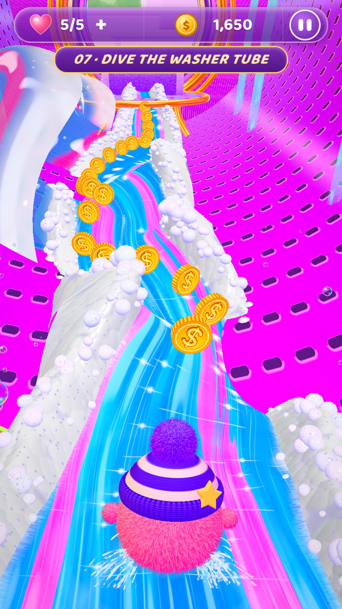
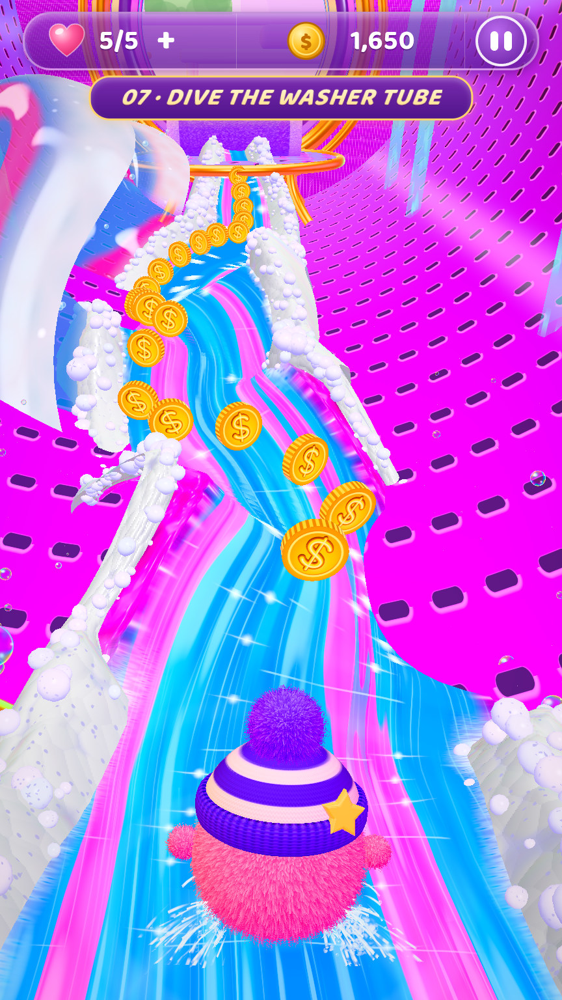
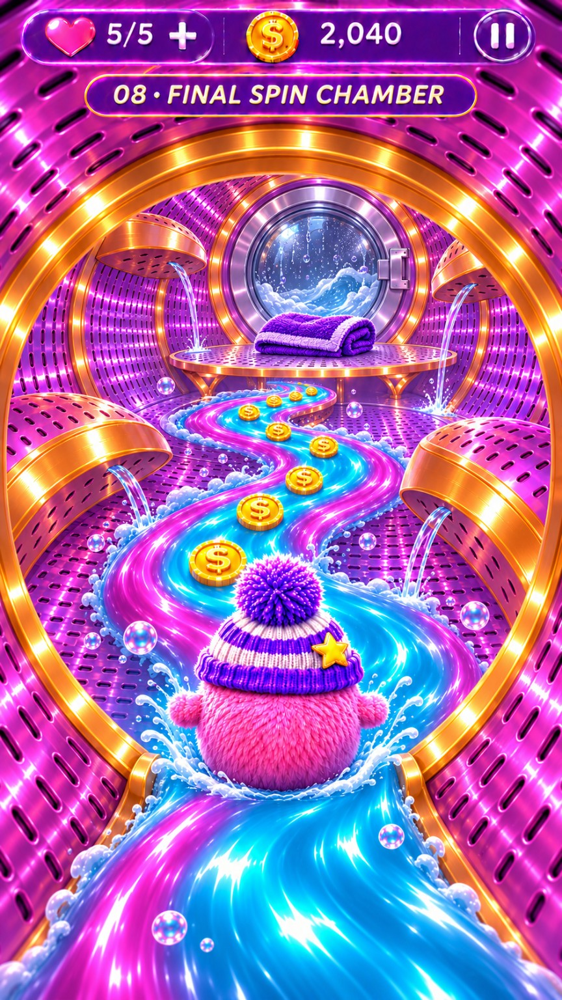
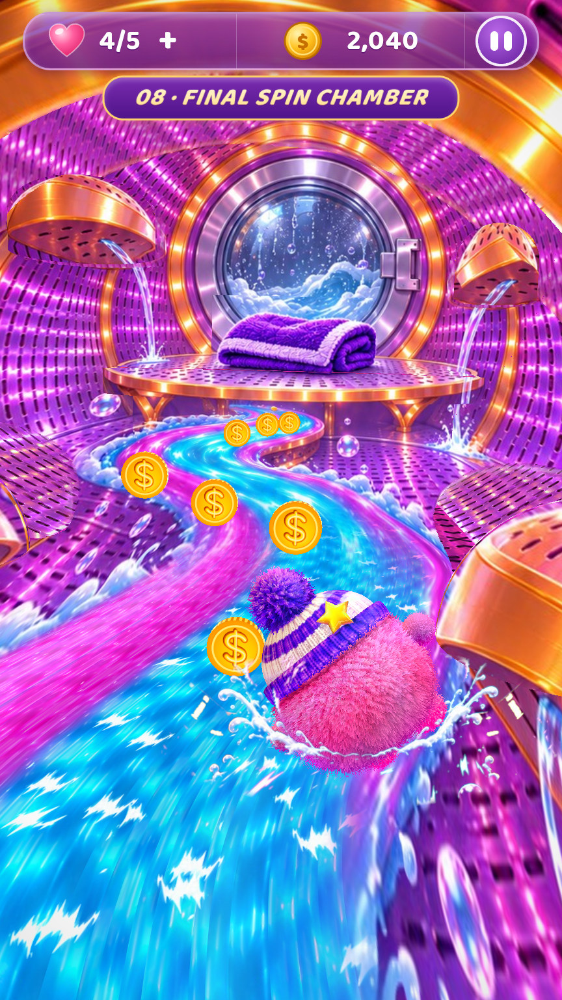
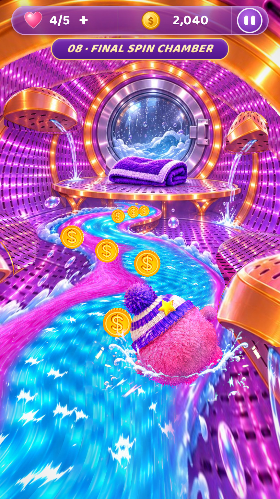

# Rainbow on your phone

Scroll to see the original artwork, Claudia’s retained moving view and each experimental result. Each picture opens separately. The swimming links play or download the real game recordings.

[Download the current five-screen picture PDF](Rainbow_All_Five_on_Android.pdf) · [Open the earlier 37-page review](Rainbow_Visual_Review.pdf)

[Read the one-object fal.ai test and the Sleek recommendation](FAL_ONE_OBJECT_TEST.md)

## Screen 04 | Through the Five Arrows

Look at the depth, spacing and pink-violet reflections on the farther gold rings.

**APPROVED original artwork**

**CLAUDIA BEFORE**

Twenty units into the gold corridor.

[Open the full-size retained frame](https://github.com/josiahscalia5-dev/rainbow-/blob/c0c06b2ad4fdfb6f6a8942068d7d820f0887268a/experiments/codex/s04-approved-gold-bay/CLAUDIA_BEFORE/forward-20.png) · [Watch Claudia’s swim](https://github.com/josiahscalia5-dev/rainbow-/blob/c0c06b2ad4fdfb6f6a8942068d7d820f0887268a/experiments/codex/s04-approved-gold-bay/CLAUDIA_BEFORE/ride.mp4)

**CODEX NEW | CANDIDATE**

[Watch the experimental swim](https://github.com/josiahscalia5-dev/rainbow-/blob/c0c06b2ad4fdfb6f6a8942068d7d820f0887268a/experiments/codex/s04-approved-gold-bay/CODEX_NEW/ride.mp4) · [Open this experiment’s evidence](https://github.com/josiahscalia5-dev/rainbow-/tree/c0c06b2ad4fdfb6f6a8942068d7d820f0887268a/experiments/codex/s04-approved-gold-bay)

## Screen 05 | Flow Into the Current

Follow the cyan ripples around the last bend. Long straight highlights make the water look stretched.

**APPROVED original artwork**

**CLAUDIA BEFORE**

Steering right through the final bend.

[Open the full-size retained frame](https://github.com/josiahscalia5-dev/rainbow-/blob/3c8e9812b6ce3b3895a8616ec338999469ffbed2/experiments/codex/s05-anchored-bend-highlights/CLAUDIA_BEFORE/last-right-bend.png) · [Watch Claudia’s swim](https://github.com/josiahscalia5-dev/rainbow-/blob/3c8e9812b6ce3b3895a8616ec338999469ffbed2/experiments/codex/s05-anchored-bend-highlights/CLAUDIA_BEFORE/ride.mp4)

**CODEX NEW | REJECTED**

[Watch the experimental swim](https://github.com/josiahscalia5-dev/rainbow-/blob/3c8e9812b6ce3b3895a8616ec338999469ffbed2/experiments/codex/s05-anchored-bend-highlights/CODEX_NEW/ride.mp4) · [Open this experiment’s evidence](https://github.com/josiahscalia5-dev/rainbow-/tree/3c8e9812b6ce3b3895a8616ec338999469ffbed2/experiments/codex/s05-anchored-bend-highlights)

## Screen 06 | Crest the Rinse Arch

Follow the upper edge of the water toward the gold rings on the right. Look also at the pale patch below Benny.

**APPROVED original artwork**

**CLAUDIA BEFORE**

Benny coming over the crest.

[Open the full-size retained frame](https://github.com/josiahscalia5-dev/rainbow-/blob/9dd211bebe3c3ac32834935fb83f6881491901c4/experiments/codex/s06-crest-wall-seam/CLAUDIA_BEFORE/crest-release.png) · [Watch Claudia’s swim](https://github.com/josiahscalia5-dev/rainbow-/blob/9dd211bebe3c3ac32834935fb83f6881491901c4/experiments/codex/s06-crest-wall-seam/CLAUDIA_BEFORE/ride.mp4)

**CODEX NEW | CANDIDATE**

[Watch the experimental swim](https://github.com/josiahscalia5-dev/rainbow-/blob/9dd211bebe3c3ac32834935fb83f6881491901c4/experiments/codex/s06-crest-wall-seam/CODEX_NEW/ride.mp4) · [Open this experiment’s evidence](https://github.com/josiahscalia5-dev/rainbow-/blob/9dd211bebe3c3ac32834935fb83f6881491901c4/experiments/codex/s06-crest-wall-seam/PHONE_REVIEW.md)

## Screen 07 | Dive the Washer Tube

Follow the cyan and magenta riverbanks through the drop. Large white banks interrupt the curve.

**APPROVED original artwork**

**CLAUDIA BEFORE**

Near the bottom of the plunge.

[Open the full-size retained frame](https://github.com/josiahscalia5-dev/rainbow-/blob/ba1ac8b419d5ac6b6ba43667b0de06e056464a4f/experiments/codex/s07-shared-outlet-bank/CLAUDIA_BEFORE/plunge-bottom.png) · [Watch Claudia’s swim](https://github.com/josiahscalia5-dev/rainbow-/blob/ba1ac8b419d5ac6b6ba43667b0de06e056464a4f/experiments/codex/s07-shared-outlet-bank/CLAUDIA_BEFORE/ride.mp4)

**CODEX NEW | CANDIDATE**

[Watch the experimental swim](https://github.com/josiahscalia5-dev/rainbow-/blob/ba1ac8b419d5ac6b6ba43667b0de06e056464a4f/experiments/codex/s07-shared-outlet-bank/CODEX_NEW/ride.mp4) · [Open this experiment’s evidence](https://github.com/josiahscalia5-dev/rainbow-/blob/ba1ac8b419d5ac6b6ba43667b0de06e056464a4f/experiments/codex/s07-shared-outlet-bank/PHONE_REVIEW.md)

## Screen 08 | Final Spin Chamber

Check the width of the pink bank against the cyan channel while the door, towel, platform and four spouts stay in view.

**APPROVED original artwork**

**CLAUDIA BEFORE**

Steering hard right in the chamber.

[Open the full-size retained frame](https://github.com/josiahscalia5-dev/rainbow-/blob/7ad2a51caa1722751cdf61662a3a8ff1e741e817/experiments/codex/s08-chamber-flow-distance/CLAUDIA_BEFORE/hard-right.png) · [Watch Claudia’s swim](https://github.com/josiahscalia5-dev/rainbow-/blob/7ad2a51caa1722751cdf61662a3a8ff1e741e817/experiments/codex/s08-chamber-flow-distance/CLAUDIA_BEFORE/ride.mp4)

**CODEX NEW | REJECTED**

[Watch the experimental swim](https://github.com/josiahscalia5-dev/rainbow-/blob/7ad2a51caa1722751cdf61662a3a8ff1e741e817/experiments/codex/s08-chamber-flow-distance/CODEX_NEW/ride.mp4) · [Open this experiment’s evidence](https://github.com/josiahscalia5-dev/rainbow-/tree/7ad2a51caa1722751cdf61662a3a8ff1e741e817/experiments/codex/s08-chamber-flow-distance)

## Reviewing the next change

A moving view shows an interpretation where the original artwork has no camera angle. Only your approval makes it a new visual reference. Use the two swimming clips for each experiment to judge the same turn, crest or plunge.
