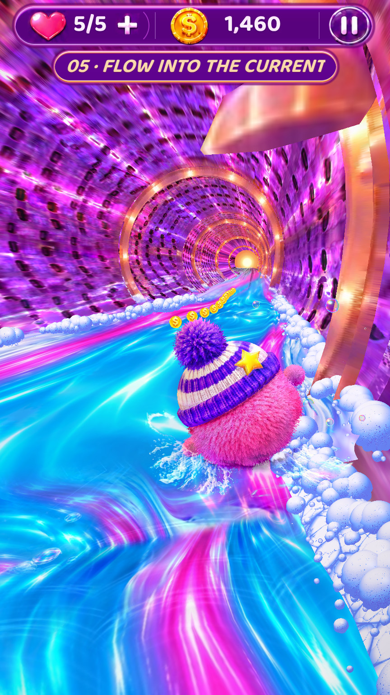

# Rainbow on your phone

Scroll to a screen to see the original artwork and Claudia’s retained moving view. Each picture opens separately. The swimming links play or download the real game recordings.

[Download the five-screen picture PDF](Rainbow_Visual_Review.pdf)

## Screen 04 | Through the Five Arrows

Look at the depth, spacing and pink-violet reflections on the farther gold rings.

**APPROVED original artwork**

**CLAUDIA BEFORE**

Twenty units into the gold corridor.

[Open the full-size retained frame](03_SCREENS/Screen_04/CLAUDIA_RETAINED/forward-20.webp) · [Watch Claudia’s swim](03_SCREENS/Screen_04/CLAUDIA_RETAINED/ride.mp4)

## Screen 05 | Flow Into the Current

Follow the cyan ripples around the last bend. Long straight highlights make the water look stretched.

**APPROVED original artwork**

**CLAUDIA BEFORE**

Steering right through the final bend.

[Open the full-size retained frame](03_SCREENS/Screen_05/CLAUDIA_RETAINED/last-right-bend.webp) · [Watch Claudia’s swim](03_SCREENS/Screen_05/CLAUDIA_RETAINED/ride.mp4)

## Screen 06 | Crest the Rinse Arch

Follow the upper edge of the water toward the gold rings on the right. Look also at the pale patch below Benny.

**APPROVED original artwork**

**CLAUDIA BEFORE**

Benny coming over the crest.

[Open the full-size retained frame](03_SCREENS/Screen_06/CLAUDIA_RETAINED/crest-release.webp) · [Watch Claudia’s swim](03_SCREENS/Screen_06/CLAUDIA_RETAINED/ride.mp4)

## Screen 07 | Dive the Washer Tube

Follow the cyan and magenta riverbanks through the drop. Large white banks interrupt the curve.

**APPROVED original artwork**

**CLAUDIA BEFORE**

Near the bottom of the plunge.

[Open the full-size retained frame](03_SCREENS/Screen_07/CLAUDIA_RETAINED/plunge-bottom.webp) · [Watch Claudia’s swim](03_SCREENS/Screen_07/CLAUDIA_RETAINED/ride.mp4)

## Screen 08 | Final Spin Chamber

Check the width of the pink bank against the cyan channel while the door, towel, platform and four spouts stay in view.

**APPROVED original artwork**

**CLAUDIA BEFORE**

Steering hard right in the chamber.

[Open the full-size retained frame](03_SCREENS/Screen_08/CLAUDIA_RETAINED/hard-right.webp) · [Watch Claudia’s swim](03_SCREENS/Screen_08/CLAUDIA_RETAINED/ride.mp4)

## Reviewing the next change

A moving view shows an interpretation where the original artwork has no camera angle. Only your approval makes it a new visual reference. Use the two swimming clips for each experiment to judge the same turn, crest or plunge.
