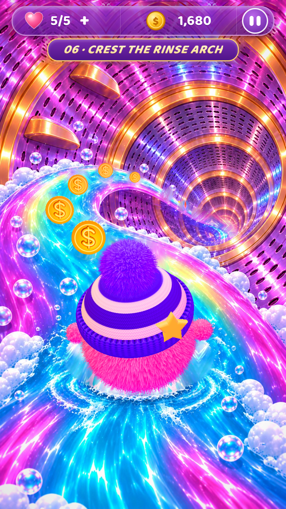
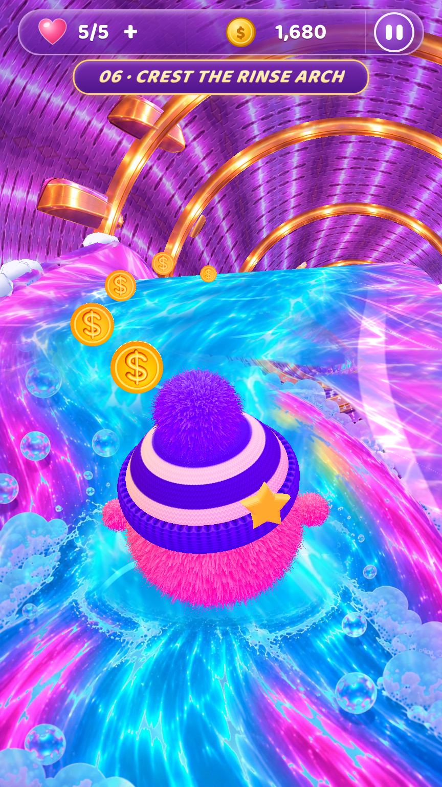
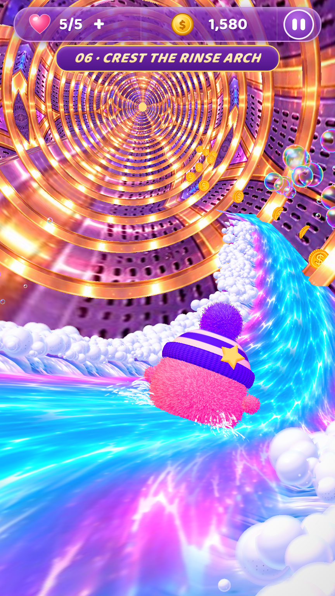
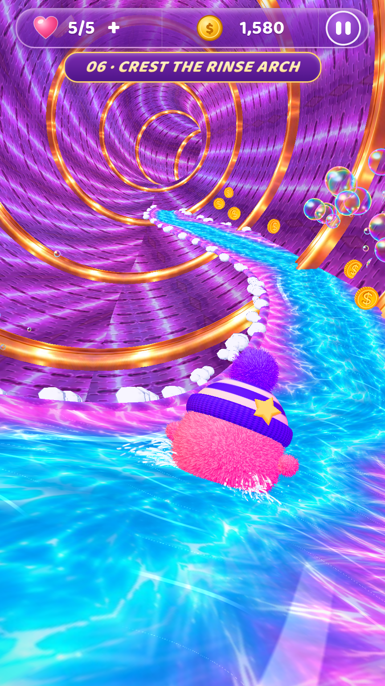

# Screen 06 on your phone

**Rejected for promotion.** The experiment improves visibility of the curved gold drum during a turn, but its water fills the purple opening inside your approved crest. Claudia’s version remains the playable baseline.

[Download the one-file picture and video review](Screen06_Review.zip) · [Open the 29-page picture PDF](Review_on_Android.pdf)

## APPROVED

Your original 864 × 1536 artwork, with its original bytes.

## CLAUDIA BEFORE

Claudia’s retained game at the original camera.

## CODEX NEW — rejected

The experimental game at the same camera, position and clock.

## Swim from the inlet into Screen 07

Open either video and compare the turns at 1.0–2.5 seconds. At 3.67–4.00 seconds, inspect the gold rings and the narrow raised river. The next stage starts at 4.92 seconds.

[Watch Claudia’s uninterrupted swim](CLAUDIA_BEFORE/ride.mp4) · [Watch the Codex uninterrupted swim](CODEX_NEW/ride.mp4)

## CLAUDIA BEFORE — deep view

## CODEX NEW — deep view

## All moving views

Every picture opens individually at 864 × 1536. These views have matched cameras, steering and clocks. They are evidence for review. The owner has approved the original artwork.

| View | Claudia before | Codex new |
| --- | --- | --- |
| Stage inlet | [Full-size picture](CLAUDIA_BEFORE/inlet.png) | [Full-size picture](CODEX_NEW/inlet.png) |
| Crest release, +1.1 | [Full-size picture](CLAUDIA_BEFORE/crest-release.png) | [Full-size picture](CODEX_NEW/crest-release.png) |
| Forward +3 | [Full-size picture](CLAUDIA_BEFORE/forward-03.png) | [Full-size picture](CODEX_NEW/forward-03.png) |
| Forward +6 | [Full-size picture](CLAUDIA_BEFORE/forward-06.png) | [Full-size picture](CODEX_NEW/forward-06.png) |
| Forward +10 | [Full-size picture](CLAUDIA_BEFORE/forward-10.png) | [Full-size picture](CODEX_NEW/forward-10.png) |
| Hard left, +12 | [Full-size picture](CLAUDIA_BEFORE/hard-left.png) | [Full-size picture](CODEX_NEW/hard-left.png) |
| Hard right, +12 | [Full-size picture](CLAUDIA_BEFORE/hard-right.png) | [Full-size picture](CODEX_NEW/hard-right.png) |
| Middle of the ride | [Full-size picture](CLAUDIA_BEFORE/middle.png) | [Full-size picture](CODEX_NEW/middle.png) |
| Forward +20 | [Full-size picture](CLAUDIA_BEFORE/forward-20.png) | [Full-size picture](CODEX_NEW/forward-20.png) |
| Deep tunnel | [Full-size picture](CLAUDIA_BEFORE/deep.png) | [Full-size picture](CODEX_NEW/deep.png) |
| Arch exit | [Full-size picture](CLAUDIA_BEFORE/arch-exit.png) | [Full-size picture](CODEX_NEW/arch-exit.png) |
| Final approach | [Full-size picture](CLAUDIA_BEFORE/last-in-stage.png) | [Full-size picture](CODEX_NEW/last-in-stage.png) |
| Transition to Screen 07 | [Full-size picture](CLAUDIA_BEFORE/across-transition.png) | [Full-size picture](CODEX_NEW/across-transition.png) |

[See the photographed crest and the measured route](diagnostics/visible-crest-and-swim.png) · [Read the verdict, measurements and remaining problems](REPORT.md)

The optional Android comparison build opens the retained and reconstructed worlds as separate choices. It uses a separate app ID. Its web content was checked in Chromium. Device performance still needs a physical Android test. [Experimental review APK](mobile/Rainbow_Crest_Proof.apk)

[Review the other four original screens and their saved swims](https://github.com/josiahscalia5-dev/rainbow-/blob/7a04d763a1ab108aa11588ede0ee338f4acd6817/OPEN_RAINBOW_ON_ANDROID.md)
